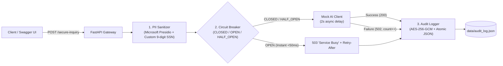

# The Guardian Integration Gateway

A secure AI middleware service built with **Python + FastAPI**, **Microsoft Presidio**, **AES-256-GCM** encrypted audit logging, and a **3-state Circuit Breaker**, packaged in Docker.

---

## Architecture



---

## Quick Start (Docker Compose)

```bash
# 1. Optional: copy .env.example to .env and set a custom 32-byte base64 ENCRYPTION_KEY
cp .env.example .env

# 2. Build and start the gateway
docker compose up --build -d

# 3. Verify health & Circuit Breaker state
curl -s http://localhost:8000/health | python3 -m json.tool
```

Interactive Swagger UI is available at **http://localhost:8000/docs**.

---

## API Usage

### 1. Normal Secure Inquiry (PII Redaction + 2s Mock AI + Encrypted Audit Log)

```bash
curl -s -X POST http://localhost:8000/secure-inquiry \
  -H "Content-Type: application/json" \
  -d '{
    "userId": "user-42",
    "message": "Contact alice@example.com, card 4532-0151-1283-0366, SSN 123-45-6789 or 987654321."
  }' | python3 -m json.tool
```

Expected response (`200 OK`, ~2000ms):
```json
{
  "userId": "user-42",
  "sanitizedMessage": "Contact <REDACTED: EMAIL>, card <REDACTED: CREDIT_CARD>, SSN <REDACTED: SSN> or <REDACTED: SSN>.",
  "answer": "Generated Answer",
  "redactedTypes": ["CREDIT_CARD", "EMAIL", "SSN"],
  "circuitState": "CLOSED",
  "latencyMs": 2008.4
}
```

Inspect the persisted audit log inside the Docker volume:
```bash
docker-compose exec guardian-gateway cat /app/data/audit_log.json
```
You will see `originalMessageEncrypted` (AES-256-GCM Base64 ciphertext) alongside `redactedMessage` (plaintext).

### 2. Triggering the Circuit Breaker (3 Consecutive Failures → Instant `503 Service Busy`)

Use the deterministic test header `X-Simulate-Failure: true` to simulate 3 consecutive upstream AI failures:

```bash
for i in 1 2 3; do
  echo "--- Failure #$i ---"
  curl -i -s -X POST http://localhost:8000/secure-inquiry \
    -H "Content-Type: application/json" \
    -H "X-Simulate-Failure: true" \
    -d "{\"userId\": \"user-$i\", \"message\": \"Simulate outage #$i\"}" | head -n 12
done
```

Now send a 4th request (even **without** the failure header) and observe the **instant** `503 Service Unavailable` with `"answer": "Service Busy"` and `latencyMs < 50`:

```bash
curl -i -s -X POST http://localhost:8000/secure-inquiry \
  -H "Content-Type: application/json" \
  -d '{"userId": "user-4", "message": "My email is bob@example.com"}'
```

After 30 seconds (`CB_RECOVERY_TIMEOUT_SECONDS`), the breaker transitions to `HALF_OPEN` and allows a single probe request to automatically restore `CLOSED` state.

---

## Running Automated Tests

Inside the Docker container (zero local Python setup needed):

```bash
docker-compose exec guardian-gateway pytest -v
```

### Running the Smoke & Stress Test Suite

Validates input boundaries (`422`), ES/EN PII red-teaming & 9.5KB ReDoS check, 20 concurrent audit writes, 50-request Circuit Breaker burst, and zero-leak AES-256-GCM integrity on `audit_log.json`:

```bash
docker-compose exec guardian-gateway python scripts/smoke_stress_test.py
```

Or locally with Python 3.10+:

```bash
python3 -m venv .venv
source .venv/bin/activate
pip install -r requirements.txt
python -m spacy download en_core_web_sm
pytest -v
```

---

## AI Orchestration & Security Engineering Decisions

This project was built using a **Spec-Driven & Security-First** workflow with **Google Antigravity (Gemini)**:

1. **Enterprise PII Detection with Custom Guardrails (`app/sanitizer.py`)**:
   - Uses **Microsoft Presidio** (`presidio-analyzer` + `presidio-anonymizer`) rather than fragile ad-hoc regexes alone.
   - **Audited Edge Case**: Presidio's default `US_SSN` recognizer requires English context words or delimiters and can miss raw 9-digit numeric sequences (especially in non-English text). We added `GuardianNineDigitSSNRecognizer` (`(?<!\d)\d{9}(?!\d)` and `\b\d{3}[-\s]\d{2}[-\s]\d{4}\b`) while relying on Presidio's Luhn-validated `CREDIT_CARD` recognizer (score `1.0`) so 16-digit card numbers are never partially split into 9-digit SSNs.
   - **Cold-Start Mitigation**: `en_core_web_sm` is baked into the Docker image at build time and `PresidioSanitizer` is pre-warmed once during FastAPI's `lifespan` startup.
2. **Authenticated Encryption at Rest (`app/crypto.py`)**:
   - Uses **AES-256-GCM** (`cryptography.hazmat.primitives.ciphers.aead.AESGCM`) with a fresh 96-bit random nonce per audit record, preventing ciphertext correlation and detecting tampering. Keys are loaded via `ENCRYPTION_KEY` environment variable.
3. **Concurrency-Safe Atomic Audit Writes (`app/audit_log.py`)**:
   - Guarded by `asyncio.Lock` and persisted via temporary file + `os.replace()` so concurrent requests cannot corrupt `data/audit_log.json`. Raw PII is never printed to application logs.
4. **Resilient 3-State Circuit Breaker (`app/circuit_breaker.py`)**:
   - Implements `CLOSED` → `OPEN` (after 3 consecutive failures) → `HALF_OPEN` (single probe after cooldown) with `asyncio.Lock`, returning HTTP `503` + `Retry-After` + `"answer": "Service Busy"` immediately without waiting for the 2-second AI delay.
5. **Hardened Containerization (`Dockerfile`)**:
   - Runs as a dedicated non-root user (`guardian`), includes a built-in `HEALTHCHECK`, and isolates secrets via `.env.example` / `.gitignore`.

---

## 2–3 Minute Video Demo Checklist

1. **Start Stack**: Run `docker compose up --build -d` and `curl http://localhost:8000/health`.
2. **Automated Tests**: Run `docker compose exec guardian-gateway pytest -v` to show all security, encryption, circuit breaker, and API tests passing.
3. **Happy Path + PII Redaction**: Call `POST /secure-inquiry` (via `curl` or Swagger UI at `http://localhost:8000/docs`) with an email, credit card, and SSN; highlight the ~2s response, `<REDACTED: TYPE>` output, and `"Generated Answer"`.
4. **Audit Log Verification**: Run `docker-compose exec guardian-gateway cat /app/data/audit_log.json` to show `originalMessageEncrypted` (unreadable ciphertext) vs. `redactedMessage` (plaintext).
5. **Circuit Breaker Twist**: Send 3 requests with `X-Simulate-Failure: true`, check `/health` (`"state": "OPEN"`), then send a 4th normal request showing instant `503` `"Service Busy"` in `<50ms` (no 2-second wait).
