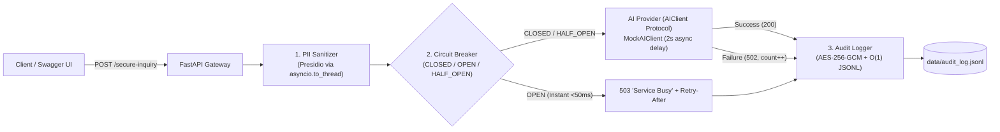

# The Guardian Integration Gateway

A secure AI middleware service built with **Python + FastAPI**, **Microsoft Presidio**, **AES-256-GCM** encrypted O(1) JSONL audit logging, and a **3-state Circuit Breaker**, packaged in Docker.

---

## Architecture



---

## Quick Start (Docker Compose)

```bash
# 1. Optional: copy .env.example to .env and set a custom 32-byte base64 ENCRYPTION_KEY
cp .env.example .env

# 2. Build and start the gateway
docker-compose up --build -d

# 3. Verify health & Circuit Breaker state
curl -s http://localhost:8000/health | python3 -m json.tool
```

Interactive Swagger UI is available at **http://localhost:8000/docs**.

---

## API Usage

### 1. Normal Secure Inquiry (PII Redaction + 2s Mock AI + Encrypted Audit Log)

```bash
curl -s -X POST http://localhost:8000/secure-inquiry \
  -H "Content-Type: application/json" \
  -d '{
    "userId": "user-42",
    "message": "Contact alice@example.com, card 4532-0151-1283-0366, SSN 123-45-6789 or 987654321."
  }' | python3 -m json.tool
```

Expected response (`200 OK`, ~2000ms):
```json
{
  "userId": "user-42",
  "sanitizedMessage": "Contact <REDACTED: EMAIL>, card <REDACTED: CREDIT_CARD>, SSN <REDACTED: SSN> or <REDACTED: SSN>.",
  "answer": "Generated Answer",
  "redactedTypes": ["CREDIT_CARD", "EMAIL", "SSN"],
  "circuitState": "CLOSED",
  "latencyMs": 2008.4
}
```

Inspect the persisted O(1) JSON Lines audit log inside the Docker volume:
```bash
docker-compose exec guardian-gateway cat /app/data/audit_log.jsonl
```
Each line is a self-contained JSON record with `originalMessageEncrypted` (AES-256-GCM Base64 ciphertext) alongside `redactedMessage` (plaintext).

### 2. Triggering the Circuit Breaker (3 Consecutive Failures → Instant `503 Service Busy`)

In non-production environments (`ENVIRONMENT=development`), use the deterministic header `X-Simulate-Failure: true` to simulate 3 consecutive upstream AI failures (this header is automatically ignored when `ENVIRONMENT=production` to prevent DoS):

```bash
for i in 1 2 3; do
  echo "--- Failure #$i ---"
  curl -i -s -X POST http://localhost:8000/secure-inquiry \
    -H "Content-Type: application/json" \
    -H "X-Simulate-Failure: true" \
    -d "{\"userId\": \"user-$i\", \"message\": \"Simulate outage #$i\"}" | head -n 12
done
```

Now send a 4th request (even **without** the failure header) and observe the **instant** `503 Service Unavailable` with `"answer": "Service Busy"` and `latencyMs < 50`:

```bash
curl -i -s -X POST http://localhost:8000/secure-inquiry \
  -H "Content-Type: application/json" \
  -d '{"userId": "user-4", "message": "My email is bob@example.com"}'
```

After 30 seconds (`CB_RECOVERY_TIMEOUT_SECONDS`), the breaker transitions to `HALF_OPEN` and allows a single probe request to automatically restore `CLOSED` state.

---

## Running Automated Tests

Inside the Docker container (zero local Python setup needed):

```bash
docker-compose exec guardian-gateway pytest -v
```

### Running the Smoke & Stress Test Suite

Validates input boundaries (`422`), ES/EN PII red-teaming & 9.5KB ReDoS check, 20 concurrent audit writes, 50-request Circuit Breaker burst, automatic `OPEN` → `HALF_OPEN` → `CLOSED` recovery, and zero-leak AES-256-GCM integrity on `audit_log.jsonl`:

```bash
docker-compose exec guardian-gateway python scripts/smoke_stress_test.py
```

Or locally with Python 3.10+:

```bash
python3 -m venv .venv
source .venv/bin/activate
pip install -r requirements.txt
python -m spacy download en_core_web_sm
pytest -v
```

---

## AI Orchestration & Security Engineering Decisions

This project was built using a **Spec-Driven & Security-First** workflow with **Google Antigravity (Gemini)**, followed by an adversarial security audit:

1. **Two-Layer Enterprise PII Detection Off the Event Loop (`app/sanitizer.py`, `app/main.py`)**:
   - **Layer 1 (Regex Fast-Path)**: A linear-time compiled regex (`@|\d(?:[\s-]?\d){8,}`) short-circuits clean messages and short numeric references in `<0.1ms` without invoking Presidio.
   - **Layer 2 (Deterministic Presidio)**: Uses a minimalist `RecognizerRegistry` with only `CreditCardRecognizer` (Luhn), `EmailRecognizer`, `UsSsnRecognizer`, and our custom `GuardianNineDigitSSNRecognizer`, excluding `SpacyRecognizer` (neural NER) and stripping spaCy's heavy `ner` and `parser` pipes from `en_core_web_sm` for language-agnostic, low-CPU execution.
   - **Audited Edge Case**: Presidio's default `US_SSN` recognizer requires English context words or delimiters and can miss raw 9-digit numbers. `GuardianNineDigitSSNRecognizer` (`(?<!\d)\d{9}(?!\d)` and `\b\d{3}[-\s]\d{2}[-\s]\d{4}\b`) catches them reliably while Presidio's Luhn-validated `CREDIT_CARD` recognizer (score `1.0`) prevents 16-digit cards from splitting into 9-digit SSNs.
   - **Non-blocking Execution**: `sanitizer.sanitize()` runs via `await asyncio.to_thread(...)` so large payloads never block uvicorn's async event loop.
2. **Fail-Safe Production Configuration (`app/config.py`)**:
   - Startup validation via Pydantic `@model_validator` **refuses to boot** if `ENVIRONMENT=production` uses the default demo `ENCRYPTION_KEY`.
   - `X-Simulate-Failure` is strictly gated by `ENVIRONMENT != "production"` (`can_simulate_failures`), eliminating header-based DoS vectors in production.
3. **Authenticated Encryption at Rest (`app/crypto.py`)**:
   - Uses **AES-256-GCM** (`AESGCM`) with a fresh 96-bit random nonce per record, preventing ciphertext correlation and detecting tampering.
4. **O(1) Append-Only Audit Log (`app/audit_log.py`)**:
   - Uses **JSON Lines (`audit_log.jsonl`)** with `asyncio.Lock` + `os.fsync()` instead of O(n) full-file JSON array rewrites, scaling smoothly under sustained concurrency while never printing raw PII to application logs.
5. **Resilient 3-State Circuit Breaker (`app/circuit_breaker.py`, `app/ai_client.py`)**:
   - Decoupled via `AIClient` `Protocol` and configured with `expected_exceptions=(AIServiceError,)` so internal programming bugs never falsely trip the breaker.
   - Guards `_opened_at` so late failures from concurrent in-flight calls cannot unfairly reset the cooldown timer once `OPEN`.
6. **Hardened Containerization (`Dockerfile`)**:
   - Runs as a dedicated non-root user (`guardian`), includes a built-in `HEALTHCHECK`, and isolates secrets via `.env.example` / `.gitignore`.
